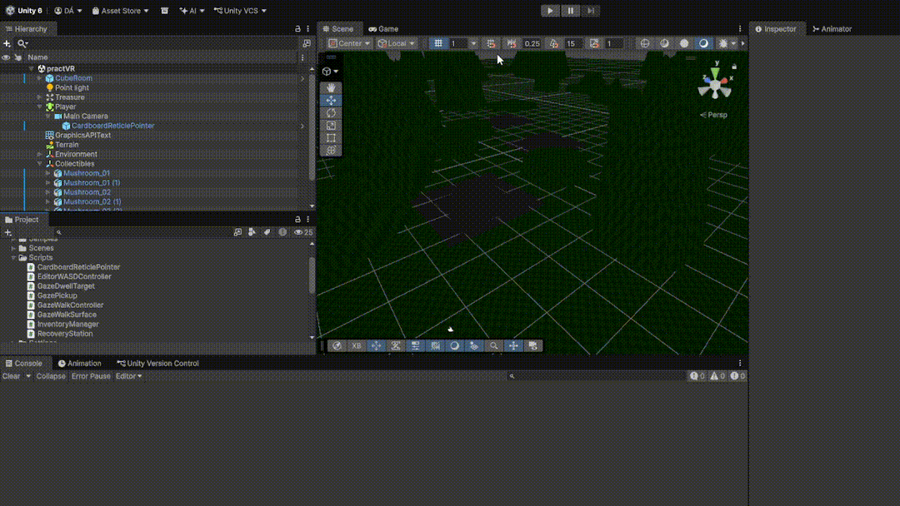
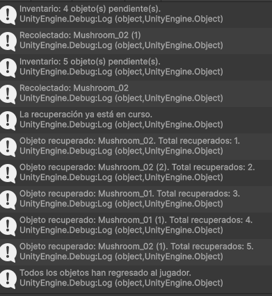

# Práctica 5: Google Cardboard con Unity

## Autor  
Daniel Palenzuela Álvarez alu0101140469

## 1. Objetivo

Desarrollar una experiencia de realidad virtual para Android con Google Cardboard. El jugador explora un escenario 3D, se desplaza dirigiendo la mirada al terreno, recoge objetos manteniendo la vista sobre ellos y puede activar una estación recuperadora para atraer los objetos recogidos hacia su posición.

La práctica queda dividida en tres ejercicios:

1. Crear el proyecto Cardboard, probar `HelloCardboard` y generar una APK Android.
2. Construir una escena con terreno y recursos 3D de la Asset Store, con movimiento y recolección mediante la mirada.
3. Añadir una estación que, al seleccionarla con la mirada, haga que los recolectables vuelvan hacia el jugador.

## 2. Requisitos y recursos

- Unity Editor **6.6** con el módulo **Android Build Support**.
- Android SDK, Android NDK y OpenJDK instalados desde Unity Hub.
- Git instalado y disponible en la variable `PATH`.
- Un teléfono Android compatible.
- Paquete **Google Cardboard XR Plugin for Unity**.
- Un paquete de terreno/vegetación/objetos 3D de la Asset Store "Low-Poly Simple Nature Pack".

## 3. Ejercicio 1: Proyecto Cardboard y APK Android

### 3.1 Crear el proyecto e importar el SDK

1. Abrir Unity.
2. Crear un proyecto 3D llamado `VRCollector`.
3. En Unity, abrir `Window > Package Manager`.
4. Pulsar `+` y elegir `Add package from git URL`.
5. Introducir la URL oficial:

   ```text
   https://github.com/googlevr/cardboard-xr-plugin.git
   ```

6. Seleccionar el paquete Google Cardboard XR Plugin y pulsar `Import` en su sección **Samples**.
7. Abrir la escena de demostración `HelloCardboard` ubicada en:

   ```text
   Assets/Samples/Google Cardboard/<version>/Hello Cardboard/Scenes
   ```

8. Ejecutar la escena y comprobar que se muestra el entorno estereoscópico y que el puntero de Cardboard responde a la mirada.

Para desarrollar el juego, duplico como `Assets/Scenes/VRCollector.unity` y modificar la copia, manteniendo los objetos de inicialización y del jugador que aporta el ejemplo.

### 3.2 Configurar las capas de interacción de Cardboard

1. Abrir `Layers > Edit Layers...` y crear una capa llamada `Interactive`.
2. Asignar esta capa a los objetos que deban recibir interacciones por mirada: terreno, recolectables y estación recuperadora.
3. En la jerarquía, localizar `Player > Camera > CardboardReticlePointer`.
4. En el componente **Cardboard Reticle Pointer**, incluir `Interactive` en `Reticle Interaction Layer Mask`.
5. No eliminar el `EventSystem` ni el módulo de entrada que trae la escena de ejemplo.

Los objetos 3D que deban recibir la mirada necesitan un `Collider`. El terreno creado con Unity Terrain dispone normalmente de `TerrainCollider`, los objetos importados pueden necesitar un `BoxCollider`, `SphereCollider` o `MeshCollider`, según su forma.

### 3.3 Corregir `CardboardStartup.cs`

En el script `CardboardStartup.cs` importado con la muestra, localizar la llamada `Api.UpdateScreenParams();` al final del método `Update()` y dejarla protegida por esta directiva:

```csharp
#if !UNITY_EDITOR
    Api.UpdateScreenParams();
#endif
```

### 3.4 Configurar Android

La guía oficial de Cardboard describe estos ajustes. En Unity 6.6 la interfaz de compilación se organiza mediante **Build Profiles**.

1. Abrir `File > Build Profiles`.
2. Seleccionar Android y cambiar a esa plataforma.
3. Incluir `VRCollector.unity` en la lista de escenas del perfil Android.
4. En `Edit > Project Settings > Player > Resolution and Presentation`:
   - `Default Orientation`: `Landscape Left` o `Landscape Right`.
   - Desactivar `Optimized Frame Pacing`.
5. En `Player > Other Settings`:
   - `Graphics APIs`: utilizar `OpenGLES3` o `Vulkan`. Para empezar, `OpenGLES3` evita los ajustes particulares de Vulkan.
   - `Minimum API Level`: Android 8.0 / API 26 o superior.
   - `Target API Level`: API 35 o superior, como indica la guía de Cardboard consultada.
   - `Scripting Backend`: `IL2CPP`.
   - `Target Architectures`: activar `ARM64` y `ARMv7`.
   - `Internet Access`: `Require`.
   - `Active Input Handling`: `Input System Package (New)`.
   - `Package Name`: establecer un identificador propio, por ejemplo `es.tudominio.vrcollector`.
   - `Application Entry Point`: seleccionar `Activity` y desactivar `GameActivity`.
6. En `XR Plug-in Management > Android`, habilitar `Cardboard XR Plugin`.
7. En `Player > Publishing Settings > Build`, activar `Custom Main Gradle Template` y `Custom Gradle Properties Template`.
8. En `Assets/Plugins/Android/mainTemplate.gradle`, añadir las dependencias dentro del bloque `dependencies { ... }` existente, sin crear un bloque duplicado:

   ```gradle
   implementation 'androidx.appcompat:appcompat:1.6.1'
   implementation 'com.google.android.gms:play-services-vision:20.1.3'
   implementation 'com.google.android.material:material:1.12.0'
   implementation 'com.google.protobuf:protobuf-javalite:3.19.4'
   ```

9. En `Assets/Plugins/Android/gradleTemplate.properties`, añadir:

   ```properties
   android.enableJetifier=true
   android.useAndroidX=true
   ```

### 3.5 Generar y probar la APK

1. Guardar la escena y comprobar que está incluida en el perfil Android.
2. Seleccionar `Build` o `Build and Run`.
3. Guardar el archivo, por ejemplo, en `Builds/Android/VRCollector.apk`.
4. Instalar la APK en un teléfono Android y probarla.
5. Comprobar la orientación horizontal, la imagen estereoscópica, el seguimiento de la cabeza y la interacción con el puntero.

## 4. Ejercicio 2: Escena, desplazamiento y recolección

### 4.1 Construcción de la escena

Partir de la copia de `HelloCardboard` llamada `VRCollector`. Mantener la jerarquía del jugador y la configuración de Cardboard que ya funciona en la muestra.

```text
VRCollector
├── Setup
├── Player
│   └── Camera
│       └── CardboardReticlePointer
├── Terrain (Terrain + TerrainCollider)
├── Environment  (árboles, rocas, vegetación, etc.)
├── Collectibles
│   ├── Mushroom_01 (Collider + GazePickup)
│   ├── Mushroom_02 (Collider + GazePickup)
│   └── Mushroom_03 (Collider + GazePickup)
├── RecoveryStation (Collider + RecoveryStation)
└── GameSystems
    └── InventoryManager
```

1. Crear un terreno desde `GameObject > 3D Object > Terrain`.
2. Importar un paquete de vegetación, rocas y recursos de escenario de la Asset Store.
3. Colocar el jugador sobre el terreno. La cámara debe seguir siendo hija de la raíz del jugador y conservar el seguimiento de cabeza de Cardboard que trae la muestra.
4. En la raíz del jugador, añadir un `CharacterController`. Ajustar su altura y centro para que el personaje no aparezca por debajo del suelo.
5. Crear varios objetos recolectables. En cada raíz añadir un `Collider` y el script `GazePickup`.
6. Crear una estación recuperadora visible (un tronco), con `Collider` y el script `RecoveryStation`.
7. Crear un objeto vacío `GameSystems` y añadirle `InventoryManager`.

### 4.2 Movimiento mediante la mirada

El desplazamiento se implementa con `GazeWalkController` y `GazeWalkSurface`:

- `GazeWalkController` se añade a la raíz del jugador. Recibe el `CharacterController` y la cámara que representa la dirección de la cabeza.
- `GazeWalkSurface` se añade al terreno y recibe una referencia al `GazeWalkController`.
- Cuando el puntero entra en el collider del terreno, se activa el movimiento. El jugador avanza en la dirección horizontal hacia la que apunta la cámara.
- Cuando el puntero sale del terreno y entra en otro objeto interactivo, el movimiento se detiene. Así se puede mirar un recolectable o la estación sin seguir avanzando.

Para que el comportamiento funcione, el terreno y los objetos interactivos deben estar en la capa incluida en el `Reticle Interaction Layer Mask`.

### 4.3 Recolección por permanencia de la mirada

`GazePickup` hereda de `GazeDwellTarget`. Cuando el puntero entra en el objeto, comienza a contar el tiempo. Si la mirada permanece sobre él durante el tiempo configurado (un segundo por defecto), el objeto:

1. Se registra en `InventoryManager`.
2. Oculta sus renderers.
3. Desactiva sus colliders para que deje de recibir rayos.
4. Permanece registrado para que la estación pueda recuperarlo después.

El tiempo de permanencia se puede modificar en el Inspector desde el componente heredado `Gaze Dwell Target`.

## 5. Ejercicio 3: Estación recuperadora

`RecoveryStation` también hereda de `GazeDwellTarget`. Cuando el jugador mantiene la mirada sobre la estación durante el tiempo configurado:

1. La estación llama a `InventoryManager.RecallCollected()`.
2. El gestor recorre la lista de objetos recogidos.
3. Cada objeto vuelve a mostrar sus renderers y comienza una corrutina de movimiento.
4. Los recolectables se desplazan hacia el `playerTarget` (la cámara del jugador, asignada desde el Inspector).
5. Al alcanzar al jugador, cada objeto vuelve a ocultarse y se elimina de la lista de pendientes de recuperación.

El número de objetos recuperados y el estado de la operación se muestran mediante mensajes en la consola (`Debug.Log`).

## 6. Explicación de los scripts

Los scripts se encuentran en `Assets/Scripts/`.

| Script | Responsabilidad |
|---|---|
| `GazeDwellTarget.cs` | Clase base que recibe `OnPointerEnter` y `OnPointerExit`. Cuenta cuánto tiempo permanece la mirada y llama a `OnGazeSelected()` una sola vez por selección. |
| `GazePickup.cs` | Representa un recolectable. Se registra en el inventario, oculta sus gráficos y desactiva sus colliders. También contiene la corrutina que lo desplaza hacia el jugador cuando se recupera. |
| `InventoryManager.cs` | Mantiene la lista de recolectables recogidos, inicia el retorno de todos ellos en paralelo y registra cuántos han llegado al jugador. |
| `RecoveryStation.cs` | Representa el objeto recuperador. Al completar la selección por mirada, solicita al gestor que devuelva todos los objetos pendientes. |
| `GazeWalkController.cs` | Controla el desplazamiento de la raíz del jugador mediante `CharacterController`, aplicando velocidad horizontal y gravedad. |
| `GazeWalkSurface.cs` | Detecta cuándo el puntero está sobre el terreno y activa/desactiva el movimiento por mirada. |

## 7. Asignaciones en el Inspector

| Objeto | Componente | Referencias |
|---|---|---|
| Raíz `Player` | `CharacterController` | Ajustar altura, radio y centro |
| Raíz `Player` | `GazeWalkController` | `Controller` = CharacterController; `Head` = cámara de Cardboard |
| `Terrain` | `GazeWalkSurface` | `Walker` = GazeWalkController |
| `GameSystems` | `InventoryManager` | `Player Target` = cámara del jugador |
| Cada recolectable | `GazePickup` | `Inventory` = InventoryManager |
| Estación | `RecoveryStation` | `Inventory` = InventoryManager |
| Cámara | `CardboardReticlePointer` | `Reticle Interaction Layer Mask` incluye `Interactive` |

Los recolectables y la estación deben tener colliders habilitados antes de ser seleccionados y estar en la capa `Interactive`. El script de movimiento necesita que el terreno también sea detectable por el puntero.

## 8. Prueba de ejecución


 
